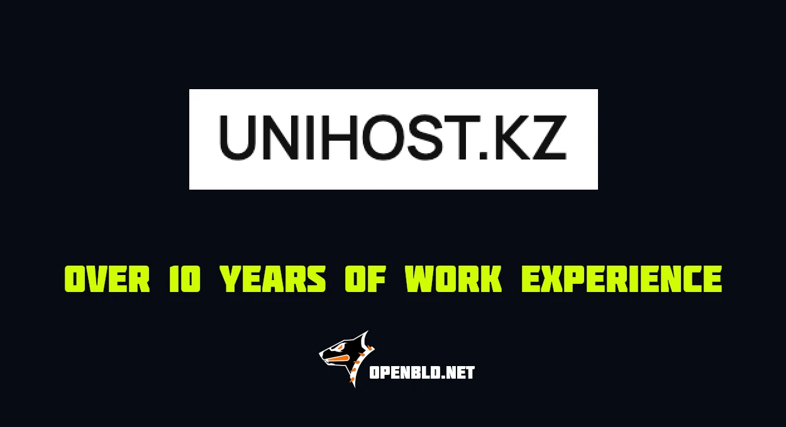

# OpenBLD and Unihost.kz 10y+ Stable Experience

For more than 10 years, OpenBLD and Sys-Adm.in have relied on infrastructure provided by Unihost.kz.
{/* truncate */}
This is the longest-running partnership in OpenBLD’s history. Reliable performance, high-quality network connectivity, and most importantly - the company’s generous, free-of-charge support helped make the launch of the public OpenBLD.net service possible.

Several servers in Almaty have remained part of our infrastructure throughout this period, including a dedicated uptime monitoring node, supporting both our services and the wider OpenBLD ecosystem.

More than a decade later, they are still doing their job.

Thank you, Unihost.kz, for supporting OpenBLD and helping us keep the Internet a little safer 🚀

#### Updates

- Official [Telegram](https://t.me/openbld)
